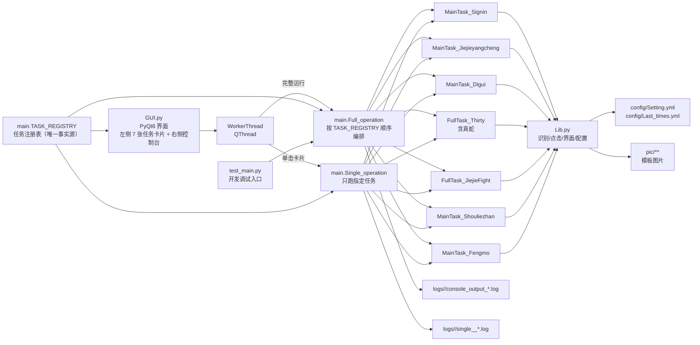

# 项目架构与任务地图

> 本文档描述 Paper Sweeper（阴阳师纸人扫地工）当前版本的整体架构、任务编排、公共库职责与配置/日志机制。
> 修改任务流程、界面导航或 `Lib.py` 公共函数前，请先阅读本文档，确保变更不破坏 `GUI.py → main.py → Task_*` 的调用链。

## 1. 项目概述

本项目用于在 Windows + MuMu 模拟器环境下，自动化完成《阴阳师》双账号日常，主要支持：

- 按窗口标题定位账号窗口（`master` / `slaves`），未找到时尝试按 `Setting.yml` 启动命令拉起模拟器；
- OpenCV 模板匹配识别界面元素，Win32 / pyautogui / pydirectinput 完成点击与按键；
- 任务级冷却与时间窗门禁，结果写回 `Last_times.yml`；
- 日志双写（控制台 + `logs/<日期>/`），GUI 实时展示；
- 当前任务域覆盖：签到收菜、结界养成、地域鬼王、寮三十与真蛇、结界突破、狩猎战/阴界、逢魔之时。

当前代码版本：GUI 标题标注 `v1.1.0`。

## 2. 顶层架构



### 目录结构

```
<workspace>/
├── AGENTS.md                      项目要求与协作约定
├── ARCHITECTURE.md                架构与任务说明
├── README.md                      使用说明
├── requirements.txt               Python 依赖
├── .gitignore                     忽略虚拟环境/配置/日志/打包产物/调试脚本
├── GUI.py                         PyQt6 图形入口（左侧 7 张任务卡片 + 右侧控制台）
├── GUI.spec                       PyInstaller 打包配置
├── build_exe.py                   本地打包脚本（调用 GUI.spec，产物输出到根目录）
├── GUI.exe                        打包产物（默认忽略）
├── main.py                        任务注册表 + 完整/单任务运行编排 + Tee 日志
├── Lib.py                         公共自动化库（识别/点击/界面/配置/编队）
├── Task_SignIn.py                 登录收菜：邮件/签到/福袋/纸人/礼包/友情点
├── Task_Jiejieyangcheng.py        结界养成：工资/寄养/结界卡/育成/食盒酒壶
├── Task_Digui.py                  地域鬼王
├── Task_Thirty.py                 寮三十（御魂协作）与真蛇
├── Task_JiejieFight.py            结界突破
├── Task_Shouliezhan.py            狩猎战（麒麟）与阴界之门
├── Task_Fengmo.py                 逢魔之时
├── test.py / test_main.py         开发调试入口（已忽略，不参与交付）
├── config/                        运行配置（默认忽略）
│   ├── Setting.yml                启动项、结界突破、寮三十副本表
│   └── Last_times.yml             各账号各任务上次完成时间
├── pic/                           界面模板图
│   ├── Main/                      庭院/弹窗/协作/返回等通用元素
│   ├── Sign/                      签到与收菜
│   ├── Mail/                      邮件
│   ├── Sis/                       阴阳寮与结界
│   ├── Team/                      编组与队伍预设
│   ├── Thr/                       御魂副本与真蛇
│   ├── Digui/                     地域鬼王
│   ├── Fengmo/                    逢魔
│   ├── JiejieFight/               结界突破
│   └── Shouliezhan/               狩猎战/阴界
├── logs/<YYYY-MM-DD>/             运行日志（console_output_*.log / single_<key>_*.log）
└── build/ __pycache__/ .venv/     构建与环境产物（GUI.exe 直接生成在根目录）
```

## 4. 数据 / 控制流向

主处理链路如下：

```
GUI.py 点击「完整运行」/ 单击左侧某张任务卡片
        ↓
config.stop_thread = False
        ↓
WorkerThread(task_key).run()        # task_key=None 表示完整运行
        ↓
task_key is None → main.Full_operation(console_signal)
否则            → main.Single_operation(task_key, console_signal)
        ↓
Tee 重定向 stdout → 控制台 + logs/<date>/<日志前缀>_*.log + GUI 信号
        ↓
依次调用 MainTask_* / FullTask_*（完整运行按 TASK_REGISTRY 顺序，单任务只调用一项）
        ↓
每个任务：
  1) read_config(Last_times.yml) 遍历账号（master/slaves）
  2) check_lasttime 判断冷却 / 时间窗 / 星期
  3) Find_windows(Account) 获取句柄，必要时 Log_in 启动
  4) 状态机 + 模板匹配执行业务
  5) 成功则 write_config 更新 Last_times.yml
        ↓
流程结束，恢复 stdout；GUI 对比运行前后的完成时间，回填卡片徽章
```

`Full_operation` 与 `Single_operation` 都通过 `main._log_stream` 统一安装/恢复日志流，区别只在日志文件名前缀（`console_output_` / `single_<key>_`）。

## 5. 入口函数说明

### 5.1 `GUI.py`

职责：

- 设置 Windows DPI：`QT_QPA_PLATFORM=windows:dpiawareness=1`；
- 安装全局异常钩子，未捕获异常写入 `app_crash.log`；
- 左侧 7 张任务卡片（由 `main.TASK_REGISTRY` 驱动，与完整运行同顺序），右侧控制台与「完整运行」按钮；
- `WorkerThread` 持有 `task_key`：`None` 时调用 `main.Full_operation`，否则调用 `main.Single_operation`；
- 卡片单击即单独运行该任务，运行期间所有卡片与「完整运行」按钮一起禁用（`MainWindow.busy` 互斥）；
- 结束后刷新卡片「上次完成」时间，并按完成时间是否推进回填徽章：`已完成` / `未更新` / `异常`。

交互约定：

| 操作 | 行为 |
| ---- | ---- |
| 单击左侧卡片 | 只运行该卡片对应的顶层任务（对 `Last_times.yml` 全部账号），冷却与时间窗照旧生效 |
| 单击「完整运行」 | 按 `TASK_REGISTRY` 顺序执行全部 7 项 |
| 运行中再次点击 | 被 `busy` 互斥拒绝，不会启动第二个线程 |
| 运行中关闭窗口 | 弹确认框；确认后置位 `config.stop_thread` 并短暂等待线程 |

注意：`GUI.py` / `test_main.py` 会 `import config`。仓库中当前没有 `config.py` 源文件；本地运行前需在项目根目录自备，至少包含：

```python
stop_thread = False
```

### 5.2 `main.py`

调用形式：

```python
Full_operation(console_signal=None)              # 完整运行
Single_operation(task_key, console_signal=None)  # 单任务运行，返回 {key, ok, reason}
```

职责：

- 维护 `TASK_REGISTRY`：`(key, title, desc, entry, lasttime_keys)` 元组，是「卡片列表 / 完整运行顺序 / GUI 状态键」的唯一事实源；
- 创建日志文件：完整运行为 `logs/<YYYY-MM-DD>/console_output_<时间戳>.log`，单任务为 `logs/<YYYY-MM-DD>/single_<key>_<时间戳>.log`；
- 用 `Tee` 把 stdout 同时写到原控制台、日志文件和 GUI 信号；
- 完整运行按注册表顺序编排，单任务运行只调用一项；
- `_log_stream` 在 `finally` 中先恢复 `sys.stdout` 再尽力冲刷，避免无控制台环境（打包版 `GUI.exe` / `pythonw`）下 `sys.stdout is None` 造成收尾异常。

`main.py` 同时定义 `Tee`：按行缓冲，保证 GUI 控制台按完整行更新；`files` 会过滤空流，写入/冲刷失败不中断任务。

辅助函数：

| 函数 | 职责 |
| ---- | ---- |
| `get_task(key)` | 按 key 查注册表条目，未登记返回 `None` |
| `read_completions()` | 一次性只读 `Last_times.yml`，返回 `{账号: {任务键: datetime}}`；不创建文件、不写盘 |
| `latest_completion(entry, completions=None)` | 取该任务在所有账号、所有状态键中的最新完成时间 |
| `completion_snapshot(entries=None)` | 记录各任务当前完成时间快照 |
| `completion_advanced(before, after)` | 对比快照，返回 `{key: 是否推进}`，用于卡片徽章判定 |

### 5.3 任务模块入口

完整流程 `Full_operation` 当前顺序（即 `TASK_REGISTRY` 顺序；单任务运行复用同一入口）：

| 顺序 | 注册表 key | 卡片标题 | 入口 | 模块 | 说明 |
| ---- | ---- | ---- | ---- | ---- | ---- |
| 1 | `signin` | 登录收菜 | `MainTask_Signin()` | `Task_SignIn.py` | 邮件、每日一签、福袋、纸人、免费礼包、友情点 |
| 2 | `jiejieyangcheng` | 结界养成 | `MainTask_Jiejieyangcheng()` | `Task_Jiejieyangcheng.py` | 寮界面：工资/体力、寄养、结界卡、白达摩育成、食盒酒壶 |
| 3 | `digui` | 地域鬼王 | `MainTask_Digui()` | `Task_Digui.py` | 经探索→六道进入地鬼，时间窗 12:00–23:50，当日冷却 |
| 4 | `thirty` | 寮三十 / 真蛇 | `FullTask_Thirty()` | `Task_Thirty.py` | 寮三十协作刷本 + 非周末真蛇（周冷却） |
| 5 | `FullTask_JiejieFight()` | `Task_JiejieFight.py` | 结界突破，时间窗 7:00–23:00，1 小时冷却 |
| 6 | `MainTask_Shouliezhan()` | `Task_Shouliezhan.py` | 周四–周日阴界之门；其余日麒麟狩猎战（当日冷却） |
| 7 | `MainTask_Fengmo()` | `Task_Fengmo.py` | 逢魔之时，时间窗 17:00–21:50，当日冷却 |

任务模块通用约定：

- `MainTask_*`：读配置 → 判冷却 → 遍历账号 → 调用业务函数 → 写回时间；
- `Work_*` / 无前缀业务函数：在单窗口上执行具体点击流程，返回 `1` 成功 / `0` 失败；
- 复杂界面用状态机字符串推进，异常统一 `Itface_Host` 回庭院后退出。

### 5.4 `Lib.py` 公共库

| 类别 | 函数 | 职责 |
| ---- | ---- | ---- |
| 窗口 | `Find_windows` | 按标题子串枚举可见窗口；找不到则 `Log_in` 启动后再找 |
| 登录 | `Log_in` | 按 `Setting.yml.启动项` 拉起 MuMu，处理适龄提示 |
| 识别 | `Img_read_ch` / `Match_model` | 中文路径读图；`TM_SQDIFF_NORMED` 模板匹配，阈值越小越严 |
| 识别 | `Find_in_windows_Matchs` / `Find_in_windows_Range` / `Find_multiple_in_windows_Matchs` | 窗口截图匹配 / 区域匹配 / 多目标匹配（匹配后涂黑避免重复） |
| 识别 | `Find_in_screen_Matchs` / `Find_Click_screen` | 全屏匹配与点击（协作拒绝等） |
| 操作 | `Move_to_range` / `Click` / `Find_Click_windows` | 识别框内随机落点点击；「找到则点」组合 API |
| 等待 | `Sleep_print` / `Sleep_print_long` / `Scroll_print` / `Esc_print` | 带日志的等待/滚轮/Esc；长等待附带拒绝协作 |
| 界面 | `Itface_Host` | 庭院复位状态机：协作→弹窗→退出标志→Esc，上限约 30 轮 |
| 界面 | `Itface_Quit` / `Itface_scroll` / `Itface_guild` / `Itface_daily` / `Itface_explore` | 退出界面、卷轴、阴阳寮、日常外显入口、探索/六道 |
| 编队 | `Team_Preset` | 式神录→预设编组→队伍→应用御魂预设 |
| 配置 | `read_config` / `write_config` / `check_lasttime` | YAML 读写；`Last_times.yml` 时间读取与缺失初始化 |

模板匹配阈值约定：`Match_model` 使用 `cv2.TM_SQDIFF_NORMED`，**数值越小越相似**；`min_val > Threshold` 视为未命中。任务代码中的阈值多在 `0.01～0.07`。

点击坐标约定：匹配框 `[(Left_up), (Right_down)]` 的中心 1/4～3/4 区域内随机点；全局坐标特例见 `Itface_scroll`（卷轴约 `((1780, 970), (1910, 1120))`）。

## 6. 配置体系

### 6.1 `config/Setting.yml`

| 键 | 含义 |
| ---- | ---- |
| `启动项.<账号>.启动命令` | MuMu 启动命令；账号名为窗口标题关键字 |
| `结界突破.<账号>.退出次数` / `开打勋章` | 结界突破策略参数 |
| `寮三十.主账号` / `副账号` | 协作刷本的两个窗口 |
| `寮三十.副本` / `次数` | 按星期（一～日）配置的副本类型与次数 |

寮三十副本类型当前支持：`魂虚`、`魂海`、`日蚀` 等；次数填 `0` 表示当日跳过。

### 6.2 `config/Last_times.yml`

结构：`<账号> -> <任务名> -> ISO 时间字符串`。

常见任务键与冷却策略：

| 任务键 | 冷却/门禁 |
| ---- | ---- |
| 邮件领取 | ≥ 1 小时 |
| 每日一签 / 福袋纸人 / 纸人奖励 | 按业务逻辑领取，部分不写时间 |
| 免费礼包 / 地域鬼王 / 逢魔之时 / 狩猎战 | 当日未完成才执行（`date` 比较） |
| 送友情点 | 业务内判断 |
| 结界养成 | ≥ 6 小时 |
| 结界突破 | ≥ 1 小时，且在 7:00–23:00 |
| 寮三十 | 两账号均已完成当日则跳过；限 9:00–23:00 |
| 真蛇 | 按 ISO 周（`isocalendar` 周序号），非周末执行 |

`check_lasttime` 在键缺失时初始化为 `2000-01-01 00:00:00`。

### 6.3 项目级 `config.py`

- 用途：GUI 线程停止标志（`config.stop_thread`）。
- 状态：源码树中不存在该文件；属于运行时必需的本地模块。
- 最小内容：`stop_thread = False`。
- 生成方式：可手写，也可执行 `python build_exe.py` 时由脚本自动生成（已存在则不改动）。

## 7. 关键模块与算法

### 7.1 模板匹配流水线

1. `win32gui.GetWindowRect` 取窗口矩形；
2. `pyautogui.screenshot(region=...)` 截取窗口；
3. `cv2.cvtColor` 转 BGR；
4. `cv2.matchTemplate(..., TM_SQDIFF_NORMED)`；
5. `minMaxLoc` 得最小值与位置，结合模板尺寸得到 `Left_up/Right_down`；
6. 阈值判定后返回区间与得分字符串。

中文路径通过 `Img_read_ch`（`np.frombuffer` + `cv2.imdecode`）读取。

### 7.2 界面状态机

典型模式：

```python
current_state = "庭院界面"
for step in range(30):
    match current_state:
        case "庭院界面":
            ...
            current_state = "寮界面"
        case "异常退出":
            Itface_Host(Hwnd)
            return 0
```

`Itface_Host` 是全局兜底：检测庭院 → 处理协作/弹窗/退出标志 → 必要时 Esc，失败返回 `0`。

### 7.3 双账号协作（寮三十 / 真蛇）

- 从 `Setting.yml` 取主/副账号与窗口句柄；
- `Team_Preset` 切换对应副本编队；
- 两窗口交替进入组队/挑战流程；
- 真蛇额外处理「御魂装配」等前置状态，成功后写周时间。

### 7.4 日志协议

`Tee` 将业务 `print` 双写。前缀语义：

| 前缀 | 含义 |
| ---- | ---- |
| `TASK-` | 任务开始/结束 |
| `STEP-` | 状态机跳转 |
| `INFO-` | 识别结果与业务信息（常带匹配得分） |
| `WAIT-` | 等待 |
| `SKIP-` | 冷却未到或时间窗外跳过 |
| `TIME-` | 上次/本次任务时间 |
| `MOVE-` / `QUIT-` | 滚轮、Esc 等操作 |
| `MAIN-` | 完整流程 / 单任务运行起止 |

GUI 崩溃日志：`app_crash.log`（`logging` + `sys.excepthook`）。

单任务运行在 `MAIN-` 起止行中带任务标题，例如：

```
MAIN- ===== 单任务运行开始：逢魔之时 ================================================
...
MAIN- ===== 单任务运行结束：逢魔之时 ================================================
```

## 8. 输出与运行产物

```
<workspace>/
├── logs/<YYYY-MM-DD>/console_output_<timestamp>.log   完整运行日志
├── logs/<YYYY-MM-DD>/single_<key>_<timestamp>.log     单任务运行日志
├── app_crash.log                                      未捕获异常
├── config/Last_times.yml                              任务冷却状态（本地）
├── build/                                             PyInstaller 中间产物
├── GUI.exe                                            打包产物（直接在根目录，默认忽略）
└── __pycache__/                                       字节码缓存
```

运行模式：

| 方式 | 命令/入口 | 说明 |
| ---- | ---- | ---- |
| GUI | `python GUI.py` | 单击左侧卡片跑单个任务；「完整运行」按注册表顺序跑全套 |
| 脚本 | 调用 `main.Full_operation()` | 无 GUI，输出到控制台与日志 |
| 脚本 | 调用 `main.Single_operation("<key>")` | 单个任务，日志写到 `logs/<日期>/single_<key>_*.log` |
| 调试 | `test.py` / `test_main.py` | 单点验证模板/任务，已 gitignore |
| 打包 | `python build_exe.py` | 调用 `GUI.spec`，产物 `GUI.exe` 直接输出到项目根目录 |

## 9. 实施约束

1. 新增任务时，必须同时更新：
   - `Task_*.py` 业务模块；
   - `main.TASK_REGISTRY`（key / 卡片标题 / 说明 / 入口 / 状态键），卡片列表与完整运行顺序都由它驱动；
   - `Last_times.yml` 任务键与冷却策略；
   - `ARCHITECTURE.md` / `README.md` 中的功能与目录说明。
2. 新增模板图必须放进对应 `pic/<业务>/`，路径使用 `./pic/...` 相对当前工作目录。
3. 识别阈值、点击等待写在调用处，修改后需用真实窗口回归；调试可临时 `Flag_show=1` 弹出标注框。
4. 时间窗、星期分支写在 `MainTask_*` 入口层，不要埋进底层 `Lib` 点击函数。
5. 冷却成功写回、失败不写回；`Setting.yml` 只放用户可改的静态配置。
6. `config/`、`logs/`、`build/`、`dist/`、`GUI.exe`、调试脚本默认不入库；需要跟踪的新源码与文档请在 `.gitignore` 中显式排除忽略。
7. 修改 `Lib.py` 公共匹配/点击/界面函数前，确认所有 `Task_*` 调用方语义不变，尤其是返回值 `1/0` 与 `Range/Matchs` 约定。
8. 本项目通过公开 UI 自动化交互，不修改游戏文件；文档与注释避免暗示注入、外挂或协议破解能力。
