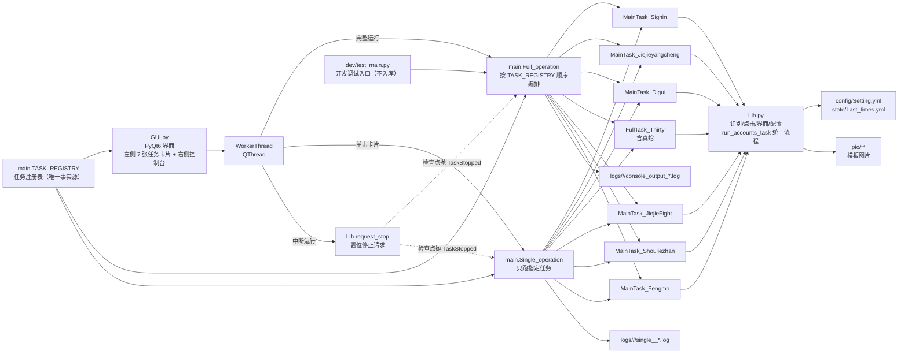

# 项目架构与任务地图

> 本文档描述 Paper Sweeper（阴阳师纸人扫地工）当前版本的整体架构、任务编排、公共库职责与配置/日志机制。
> 修改任务流程、界面导航或 `Lib.py` 公共函数前，请先阅读本文档，确保变更不破坏 `GUI.py → main.py → Task_*` 的调用链。

## 1. 项目概述

本项目用于在 Windows + MuMu 模拟器环境下，自动化完成《阴阳师》双账号日常，主要支持：

- 按窗口标题定位账号窗口（`master` / `slaves`），未找到时尝试按 `Setting.yml` 启动命令拉起模拟器；
- OpenCV 模板匹配识别界面元素，Win32 / pyautogui / pydirectinput 完成点击与按键；
- 任务级冷却与时间窗门禁，结果写回 `Last_times.yml`；
- 日志双写（控制台 + `logs/<年-月>/<日期>/`），GUI 实时展示；
- 当前任务域覆盖：签到收菜、结界养成、地域鬼王、寮三十与真蛇、结界突破、狩猎战/阴界、逢魔之时。

当前代码版本：GUI 标题标注 `v1.3.0`。

## 2. 顶层架构



### 目录结构

```
<workspace>/
├── AGENTS.md                      项目要求与协作约定
├── ARCHITECTURE.md                架构与任务说明
├── README.md                      使用说明
├── requirements.txt               Python 依赖
├── .gitignore                     忽略虚拟环境/配置/日志/打包产物/调试脚本
├── GUI.py                         PyQt6 图形入口（环境变量/日志/异常钩子 + 转出 ui 组件）
├── GUI.spec                       PyInstaller 打包配置
├── build_exe.py                   本地打包脚本（调用 GUI.spec，产物输出到根目录）
├── GUI.exe                        打包产物（默认忽略）
├── ui/                            界面层（单向依赖 theme→icons→widgets→panels→window）
│   ├── theme.py                   设计 token：颜色/间距/圆角/字号
│   ├── theme_manager.py           Fluent 主题初始化与深浅色切换
│   ├── prefs.py                   界面偏好读写（state/gui.json）
│   ├── settings_dialog.py         设置弹窗（主题 / 日志偏好 / 日志目录）
│   ├── after_run_dialog.py        完整运行设置弹窗（关闭模拟器 / 电源动作）
│   ├── thirty_settings.py         寮三十配置读写层（纯逻辑，不依赖 Qt）
│   ├── thirty_dialog.py           寮三十设置弹窗（副本 / 次数 / 主副账号）
│   ├── icons.py                   今日状态图标与齿轮/运行按钮（QPainter 绘制）
│   ├── widgets.py                 整跑开关、任务行
│   ├── panels.py                  左侧任务列表、右侧日志控制台
│   └── window.py                  主窗口与任务线程
├── main.py                        任务注册表 + 完整/单任务运行编排 + Tee 日志
├── Lib.py                         公共自动化库（识别/点击/界面/配置/编队）
├── Task_SignIn.py                 登录收菜：邮件/签到/福袋/纸人/礼包/友情点
├── Task_Jiejieyangcheng.py        结界养成：工资/寄养/结界卡/育成/食盒酒壶
├── Task_Digui.py                  地域鬼王
├── Task_Thirty.py                 寮三十（御魂协作）与真蛇
├── Task_JiejieFight.py            结界突破
├── Task_Shouliezhan.py            狩猎战（麒麟）与阴界之门
├── Task_Fengmo.py                 逢魔之时
├── dev/                            本地调试脚本（已忽略，不参与交付）
│   ├── test.py                     单点验证模板 / 界面动作
│   ├── test_main.py                单独跑某个 MainTask_* 入口
│   └── README.md                   说明与注意事项（唯一入库的文件）
├── tools/                         开发辅助脚本（不参与打包）
│   ├── check_pics.py              模板图引用检查：失效引用 / 大小写不一致 / 死图
│   ├── clean_logs.py              旧日志清理（按年月分层，默认预览）
│   └── gen_pic_readme.py          生成 pic/README.md 索引
├── config/                        静态配置（默认忽略）
│   └── Setting.yml                启动项、结界突破、寮三十副本表
├── state/                         运行期状态（默认忽略，删除即恢复初始状态）
│   ├── Last_times.yml             各账号各任务上次完成时间
│   ├── Gui_state.yml              GUI 任务开关（是否参与完整运行，缺失默认全开）
│   └── gui.json                   界面偏好（主题 / 日志 / 完成动作）
├── pic/                           界面模板图（目录英文、文件名中文，详见 pic/README.md）
│   ├── common/                    公用元素（确定/关闭/获得奖励/退出标志等）
│   ├── courtyard/                 庭院主界面与功能入口
│   ├── signin/                    登录收菜（邮件/签到/福袋/纸人/礼包/友情点）
│   ├── guild/                     结界养成（寮工资/寄养/结界卡/育成/食盒酒壶）
│   ├── breakthrough/              结界突破
│   ├── digui/                     地域鬼王
│   ├── fengmo/                    逢魔之时
│   ├── hunt/                      狩猎战（麒麟/阴界之门）
│   ├── thirty/                    寮三十与真蛇
│   └── team/                      编队预设（部分由 Team_Preset 动态拼接）
├── tools/                         开发辅助脚本（不参与打包）
│   ├── check_pics.py              模板图引用检查
│   └── gen_pic_readme.py          生成 pic/README.md 索引
├── tests/                         pytest 用例（329 个，纯逻辑不碰窗口）
├── logs/<YYYY-MM>/<YYYY-MM-DD>/   运行日志（console_output_*.log / single_<key>_*.log）
├── logs/app_crash.log             崩溃日志（随 exe 目录）
└── __pycache__/ .venv/            环境产物
```

> 打包中间产物不再落在源码树：`build_exe.py` 用 `--workpath` 把它写到
> `.dsh-scratch/build-tmp/pyinstaller/`（已忽略，可随时整体删除）。
```

## 4. 数据 / 控制流向

主处理链路如下：

```
GUI.py 点击「完整运行」/ 单击左侧某张任务卡片
        ↓
config.stop_thread = False
        ↓
WorkerThread(task_key).run()        # task_key=None 表示完整运行
        ↓
task_key is None → main.Full_operation(console_signal)
否则            → main.Single_operation(task_key, console_signal)
        ↓
Tee 重定向 stdout → 控制台 + logs/<YYYY-MM>/<YYYY-MM-DD>/<日志前缀>_*.log + GUI 信号
        ↓
依次调用 MainTask_* / FullTask_*（完整运行按 TASK_REGISTRY 顺序，单任务只调用一项）
        ↓
每个任务：
  1) read_config(Last_times.yml) 遍历账号（master/slaves）
  2) check_lasttime 判断冷却 / 时间窗 / 星期
  3) Find_windows(Account) 获取句柄，必要时 Log_in 启动
  4) 状态机 + 模板匹配执行业务
  5) 成功则 write_config 更新 Last_times.yml
        ↓
流程结束，恢复 stdout；GUI 对比运行前后的完成时间并刷新行内时间与今日状态
```

`Full_operation` 与 `Single_operation` 都通过 `main._log_stream` 统一安装/恢复日志流，区别只在日志文件名前缀（`console_output_` / `single_<key>_`）。

`Full_operation` 在开始时读取 `state/Gui_state.yml` 的任务开关，关闭的任务打印 `SKIP- ----- 任务 <标题> 已在左侧关闭 跳过` 后跳过。

## 5. 入口函数说明

### 5.1 `GUI.py` 与 `ui/` 包

`GUI.py` 只作为入口：设置 Windows DPI（`QT_QPA_PLATFORM=windows:dpiawareness=1`）、安装全局异常钩子（写入 `logs/app_crash.log`）、创建 `QApplication` 并应用主题，最后转出 `ui/` 中的组件供脚本/测试使用。

> 崩溃日志的基目录按运行形态取：源码运行时是项目根，PyInstaller 打包后是 `GUI.exe` 所在目录
> （打包后 `__file__` 指向临时解压目录，进程退出即被清理，不能用来定位日志）。

界面实现位于 `ui/` 包，依赖方向固定为 `theme → icons → widgets → panels → window`，禁止反向引用：

| 模块 | 职责 |
| ---- | ---- |
| `ui/theme.py` | 设计 token：颜色、间距、圆角、字号；`COLOR_*` 为浅色取值、深色覆盖在 `_DARK_COLORS`，组件用 `theme.color()` / `light_color()` / `dark_color()` 取色 |
| `ui/icons.py` | `StatusIcon`（QPainter 绘制对勾/感叹号/播放三角）、`IconButton`（FluentIcon 图标按钮） |
| `ui/widgets.py` | `ToggleSwitch`（Fluent `SwitchButton` 包装）、`TaskRow`（Fluent `SimpleCardWidget`）、`CountdownDialog`（可取消的倒计时确认框） |
| `ui/panels.py` | `LeftPanel`（任务列表）、`RightPanel`（Fluent `TextEdit` 日志 + 进度条 + 「关闭模拟器 / 中断运行 / 完整运行 / 设置齿轮」按钮组） |
| `ui/theme_manager.py` | Fluent 主题初始化与深浅色切换（主题偏好存 `state/gui.json`） |
| `ui/prefs.py` | 界面偏好读写（`state/gui.json`：主题 / 日志自动滚动 / 日志字号 / 两个完成动作开关） |
| `ui/settings_dialog.py` | 日志设置弹窗：主题、日志偏好与「打开日志目录」（日志区齿轮进入） |
| `ui/after_run_dialog.py` | 完整运行设置弹窗：只有「关闭模拟器」「让电脑睡眠」两个开关（按钮区齿轮进入） |
| `ui/thirty_settings.py` | 寮三十配置的**纯逻辑**读写：常量、7 项归一化、非法值回落、账号校验、YAML 保真写回。不依赖 Qt，可被 pytest 直接测 |
| `ui/thirty_dialog.py` | 「寮三十设置」弹窗：主副账号（单向约束，副账号自动跟随）+ 一周七天横排的副本/次数下拉（`thirty` 行齿轮进入） |
| `ui/jiejie_settings.py` | 结界养成配置的**纯逻辑**读写：按账号读 `优先结界卡` / `寄养优先级`、校验、YAML 保真写回；枚举与归一化复用 `Lib.JIEJIE_*`。不依赖 Qt |
| `ui/jiejie_dialog.py` | 「结界养成设置」弹窗：每个账号一张卡片（1 个放置下拉 + 横排一行的四个优先级下拉，单向互斥）（`jiejieyangcheng` 行齿轮进入） |
| `ui/window.py` | `WorkerThread`、`MainWindow`（Fluent 外壳 + 组装 + 线程调度 + 中断入口 + 完成动作触发 + `InfoBar` 结果提示） |

窗口外壳：`MainWindow` 继承 `qfluentwidgets.MSFluentWindow`，把双栏内容作为唯一子界面
`mainPage` 加入后**隐藏左侧导航**，因此保留参考项目的 Fluent 观感与无边框窗口，
信息架构仍然是「左侧任务列表 + 右侧日志控制台」两栏。

主体职责：

- 左侧 7 行任务（由 `main.TASK_REGISTRY` 驱动，与完整运行同顺序），右侧控制台与「关闭模拟器 + 中断运行 + 完整运行」按钮组；
- `WorkerThread` 持有 `task_key`：`None` 时调用 `main.Full_operation`，否则调用 `main.Single_operation`；返回值里的 `stopped` 会带进 `task_finished` 的 payload；
- 运行期间所有行的交互控件与「完整运行」「关闭模拟器」按钮一起禁用（`MainWindow.busy` 互斥），仅「中断运行」可用，并显示不确定进度条；
- 点「中断运行」→ `request_stop()` + 按钮变「中断中…」→ 线程在检查点退出 → `on_job_finished` 按 `stopped` 走「已中断」收尾（不报错、不统计完成数），界面回到待机；
- 点「关闭模拟器」→ `Lib.close_emulators()` 关闭受控模拟器窗口（详见 §5.6），控制台输出 `closed/missing/stuck` 摘要并用 `InfoBar` 提示；
- 结束后刷新行内「上次运行」时间与今日状态图标，并用 `InfoBar` 提示本次结果；
- 顶栏右侧提供深浅色主题快捷切换按钮，右侧日志区提供「清空 / 自动滚动 / 设置」工具条；
- 设置弹窗可调整主题（浅色 / 深色 / 跟随系统）、日志自动滚动与字号，并提供「打开日志目录」入口；
- 界面偏好写入 `state/gui.json`（`ui/prefs.py` 自管），任务参数与任务开关仍分别写在 `config/Setting.yml` / `state/Gui_state.yml`；
- 深浅色主题各有独立配色：文字类控件用 Fluent 标签（浅色 / 深色两套文字色由库自动切换），
  自绘状态图标、日志行着色与轮廓按钮在切换后按当前主题重新取色；主强调色是比原 `#007BFF`
  深一档的蓝（浅色 `#0d6bc2`，深色 `#3d8bd6`），避免浅色下过艳、深色下发灰看不清；
  危险色（`COLOR_DANGER` 系列）浅色 `#c42b1c`、深色柔和浅红 `#ff8b82`，与 `COLOR_LOG_ERROR` 同取值。

单行结构（从左到右）：

| 区域 | 控件 | 说明 |
| ---- | ---- | ---- |
| 今日状态 | `StatusIcon` | 今日已完成 → 绿色对勾；今日未完成 → 橙色 `!`；运行中 → 蓝色播放三角（均为 QPainter 绘制，无底色圆圈；深色主题下自动换成更亮的绿 / 橙 / 蓝） |
| 任务信息 | 名称 + 「上次运行 MM-DD HH:MM」 | 时间取该任务所有账号、所有状态键中的最新值 |
| 配置 | `IconButton(kind="gear")` | `FluentIcon.SETTING`；**按任务区分**：`thirty` 行打开「寮三十设置」弹窗（§5.8）、`jiejieyangcheng` 行打开「结界养成设置」弹窗（§5.9），其余 5 行仍是占位（弹「配置功能暂未开放」，不写盘）。提示语由 `ui/widgets.config_tooltip()` 按任务给出（映射表 `CONFIG_TOOLTIPS`） |
| 单跑 | `IconButton(kind="play")` | `FluentIcon.PLAY`；点击只运行该任务（等价于 `Single_operation`） |
| 开关 | `ToggleSwitch` | Fluent `SwitchButton`（不显示 On/Off 文案）；开 → 参与「完整运行」；关 → 完整运行时跳过、整行半透明，并写入 `state/Gui_state.yml` |

图标：齿轮与运行按钮使用 `FluentIcon`；今日状态（对勾/感叹号/播放三角）用 `QPainter` 绘制，保证任意 DPI 下清晰。右上「完整运行」为**主色**轮廓按钮（主色描边 + 主色文字，悬停同色系浅底），其左侧「中断运行」为**次要色**轮廓按钮（带 `FluentIcon.PAUSE`），再左侧「关闭模拟器」为**危险色**轮廓按钮（红色描边 + 红色文字，带 `FluentIcon.POWER_BUTTON`），都不使用实心主色块；轮廓按钮用 Fluent 的「浅色 / 深色两套自定义样式」注册，主题切换后不会退回默认实心按钮。

按钮区从左到右：**关闭模拟器 / 中断运行 / 完整运行 / 设置齿轮**。前三个按钮样式刻意拉开层次——完整运行是主色（主动作），关闭模拟器是危险色红（破坏性），中断运行是次要色灰（常规停止）。红色取值 `COLOR_DANGER` 浅色为 `#c42b1c`、深色为柔和浅红 `#ff8b82`，与 `COLOR_LOG_ERROR` 保持一致，避免深色下刺眼。末尾齿轮与日志区顶部那个同款（默认尺寸，不放大），但**走独立信号**：日志齿轮进「设置」（主题 / 日志），按钮区齿轮进「完整运行设置」（两个完成动作），两个弹窗不混放无关项，进错了页面一眼能看出。

交互约定：

| 操作 | 行为 |
| ---- | ---- |
| 点击行内 ▶ | 只运行该行对应的顶层任务（对 `Last_times.yml` 全部账号），冷却与时间窗照旧生效 |
| 点击行内齿轮 | `thirty` 行打开「寮三十设置」（§5.8）、`jiejieyangcheng` 行打开「结界养成设置」（§5.9），保存后写 `config/Setting.yml` 并在控制台打 `INFO-`；其余 5 行弹占位提示，不写任何配置 |
| 拨动行内开关 | 写入 `state/Gui_state.yml`；关闭时该行灰化，且在「完整运行」中被跳过 |
| 点击「完整运行」 | 按 `TASK_REGISTRY` 顺序执行**开关开启**的任务 |
| 点击「中断运行」 | 立即置位停止请求；任务在下一个检查点抛 `TaskStopped` 退出，界面回到待机。**不做断点续跑**，下次运行即新的一轮 |
| 点击「关闭模拟器」 | 关闭 `Setting.yml.启动项` 里登记账号对应的模拟器窗口（详见 §5.6）。**不弹二次确认**，关闭后控制台输出摘要并用 `InfoBar` 提示 |
| 点击按钮区齿轮 | 打开「完整运行设置」：只有两个完成动作开关（详见 §5.7）。写盘失败会明确提示 |
| 点击日志区齿轮 | 打开「设置」：主题、日志自动滚动、日志字号、打开日志目录（与按钮区齿轮各管一摊） |
| 运行中再次点击 | 被 `busy` 互斥拒绝，不会启动第二个线程 |
| 运行中关闭窗口 | 弹确认框；确认后同样走 `request_stop()` 并等待线程收尾 |

「中断运行」按钮位于「完整运行」左侧，为次要色轮廓按钮，**仅运行中可点**；点击后按钮变「中断中…」并禁用，防止连点。中断不处理游戏内状态（不拉回庭院、不做收尾操作），任务停在哪就是哪。

「关闭模拟器」按钮位于「中断运行」左侧，为危险色轮廓按钮，**仅空闲时可点**（运行中禁用）——正在抢占键鼠时关窗口会让任务在半途失去目标，后续每一步都必然失败。它不复用 `Find_windows`（那个函数找不到窗口会去启动游戏），改用只读枚举，详见 §5.6。

注意：`ui/window.py` 与 `Lib.py` 会在运行时 `import runtime`（`GUI.py` 本身不直接引入）。该文件属于运行期本地模块，**已被 `.gitignore` 忽略、不在版本库中**；本地运行前需在项目根目录自备，至少包含：

```python
stop_thread = False
```

### 5.2 `main.py`

调用形式：

```python
Full_operation(console_signal=None)              # 完整运行（按开关跳过已关闭任务）
Single_operation(task_key, console_signal=None)  # 单任务运行

# 返回值（PR5 起）
# Full_operation  → {"stopped": bool, "executed": int, "skipped": int}
# Single_operation → {"key": str, "ok": bool, "reason": str|None, "stopped": bool}
# 被中断时 stopped 为 True；单任务的 ok 随之为 False（这是正常收尾，不是异常）
```

职责：

- 维护 `TASK_REGISTRY`：`TaskEntry(key, title, desc, entry, lasttime_keys, today_keys)`，是「左侧行列表 / 完整运行顺序 / GUI 状态键」的唯一事实源；
- 创建日志文件：完整运行为 `logs/<YYYY-MM>/<YYYY-MM-DD>/console_output_<时间戳>.log`，单任务为 `logs/<YYYY-MM>/<YYYY-MM-DD>/single_<key>_<时间戳>.log`；
- 用 `Tee` 把 stdout 同时写到原控制台、日志文件和 GUI 信号；
- 完整运行按注册表顺序编排并按任务开关跳过，单任务运行只调用一项且**不看开关**；
- 捕获 `TaskStopped` 统一收尾（打印 `QUIT-` 与中断结束行），任务之间也会 `check_stop()`，因此上一步结束后按下的中断同样生效；
- `_log_stream` 在 `finally` 中先恢复 `sys.stdout` 再尽力冲刷，避免无控制台环境（打包版 `GUI.exe` / `pythonw`）下 `sys.stdout is None` 造成收尾异常。

中断相关名称从 `main` 重新导出（`TaskStopped` / `request_stop` / `reset_stop` / `stop_requested` / `check_stop`），GUI 层只依赖 `main`。

`main.py` 同时定义 `Tee`：按行缓冲，保证 GUI 控制台按完整行更新；`files` 会过滤空流，写入/冲刷失败不中断任务。

辅助函数：

| 函数 | 职责 |
| ---- | ---- |
| `get_task(key)` | 按 key 查注册表条目，未登记返回 `None` |
| `read_completions()` | 一次性只读 `Last_times.yml`，返回 `{账号: {任务键: datetime}}`；不创建文件、不写盘 |
| `latest_completion(entry, completions=None)` | 取该任务在所有账号、所有状态键中的最新完成时间（行内「上次运行」） |
| `completion_snapshot(entries=None)` | 记录各任务当前完成时间快照 |
| `completion_advanced(before, after)` | 对比快照，返回 `{key: 是否推进}`，用于运行结果摘要 |
| `entry_done_today(entry, completions=None, today=None)` | 判定「今日已完成」：`check_keys` 中的每个键在所有账号上都要有今天的记录 |
| `read_task_switches()` | 读取 `state/Gui_state.yml` 的任务开关，缺失默认全开，只读不建文件 |
| `is_task_enabled(key, switches=None)` / `enabled_task_keys(switches=None)` | 判断/列出参与完整运行的任务 |
| `set_task_switch(key, enabled)` | 写入单个任务开关，成功返回 `True` |

### 5.3 任务模块入口

完整流程 `Full_operation` 当前顺序（即 `TASK_REGISTRY` 顺序；单任务运行复用同一入口）：

| 顺序 | 注册表 key | 行标题 | 入口 | 模块 | 今日判定键（`today_keys`） | 说明 |
| ---- | ---- | ---- | ---- | ---- | ---- | ---- |
| 1 | `signin` | 登录收菜 | `MainTask_Signin()` | `Task_SignIn.py` | 邮件领取 / 每日一签 / 福袋纸人 / 免费礼包 / 送友情点（全部） | 邮件、每日一签、福袋、纸人、免费礼包、友情点 |
| 2 | `jiejieyangcheng` | 结界养成 | `MainTask_Jiejieyangcheng()` | `Task_Jiejieyangcheng.py` | 结界养成 | 寮界面：工资/体力、寄养、结界卡、白达摩育成、食盒酒壶；放置顺序与寄养优先级**按账号**读 `Setting.yml`（§5.9） |
| 3 | `digui` | 地域鬼王 | `MainTask_Digui()` | `Task_Digui.py` | 地域鬼王 | 经探索→六道进入地鬼，时间窗 12:00–23:50，当日冷却 |
| 4 | `thirty` | 寮三十 / 真蛇 | `FullTask_Thirty()` | `Task_Thirty.py` | 寮三十（真蛇为周更，不参与今日判定） | 寮三十协作刷本 + 非周末真蛇（周冷却） |
| 5 | `jiejiefight` | 结界突破 | `MainTask_JiejieFight()` | `Task_JiejieFight.py` | 结界突破 | 结界突破，时间窗 7:00–23:00，1 小时冷却 |
| 6 | `shouliezhan` | 狩猎战 / 阴界 | `MainTask_Shouliezhan()` | `Task_Shouliezhan.py` | 狩猎战 | 周四–周日阴界之门；其余日麒麟狩猎战（当日冷却） |
| 7 | `fengmo` | 逢魔之时 | `MainTask_Fengmo()` | `Task_Fengmo.py` | 逢魔之时 | 逢魔之时，时间窗 17:00–21:50，当日冷却 |

`today_keys` 为空表示与 `lasttime_keys` 相同（`TaskEntry.check_keys` 负责回落）。

任务模块通用约定：

- `MainTask_*`：读配置 → 判冷却 → 遍历账号 → 调用业务函数 → 写回时间；
- `Work_*` / 无前缀业务函数：在单窗口上执行具体点击流程，返回 `1` 成功 / `0` 失败；
- 复杂界面用状态机字符串推进，异常统一 `Itface_Host` 回庭院后退出。

### 5.4 `Lib.py` 公共库

| 类别 | 函数 | 职责 |
| ---- | ---- | ---- |
| 窗口 | `Find_windows` | 按标题子串枚举可见窗口；找不到则 `Log_in` 启动后再找 |
| 登录 | `Log_in` | 按 `Setting.yml.启动项` 拉起 MuMu，处理适龄提示 |
| 识别 | `Img_read_ch` / `Match_model` | 中文路径读图；`TM_SQDIFF_NORMED` 模板匹配，阈值越小越严 |
| 识别 | `Find_in_windows_Matchs` / `Find_in_windows_Range` / `Find_multiple_in_windows_Matchs` | 窗口截图匹配 / 区域匹配 / 多目标匹配（匹配后涂黑避免重复） |
| 识别 | `Find_in_screen_Matchs` / `Find_Click_screen` | 全屏匹配与点击（协作拒绝等） |
| 操作 | `Move_to_range` / `Click` / `Find_Click_windows` | 识别框内随机落点点击；「找到则点」组合 API |
| 等待 | `Sleep_print` / `Sleep_print_long` / `Scroll_print` / `Esc_print` | 带日志的等待/滚轮/Esc；长等待附带拒绝协作 |
| 界面 | `Itface_Host` | 庭院复位状态机：协作→弹窗→退出标志→Esc，上限约 30 轮 |
| 界面 | `Itface_Quit` / `Itface_scroll` / `Itface_guild` / `Itface_daily` / `Itface_explore` | 退出界面、卷轴、阴阳寮、日常外显入口、探索/六道 |
| 编队 | `Team_Preset` | 式神录→预设编组→队伍→应用御魂预设 |
| 配置 | `read_config` / `write_config` / `check_lasttime` | YAML 读写；`Last_times.yml` 时间读取与缺失初始化 |
| 编排 | `run_accounts_task` | **单账号任务固定流程**：分隔线 → 时间窗 → 遍历账号 → 取上次时间 → 准入判断 → 执行业务 → 写回时间。参数 `(name, ready, work, window=None, write_back=True)`；`ready=None` 表示硬跑（不读上次时间、不判断冷却与时间窗） |
| 编排 | `run_shared_task` | **双账号协作任务固定流程**：两账号一起判定（任一未完成即执行），业务只执行一次，成功后主副账号双写。参数 `(name, pair, work, window=None)` |
| 编排 | `ready_daily` / `ready_weekly` / `ready_after(hours)` | 准入策略：当日冷却 / 周冷却 / 距上次满 N 小时 |
| 编排 | `skip_text` | 按准入策略生成 SKIP 日志文案 |
| 编排 | `write_task_time` / `write_task_time_pair` | 写回单个账号 / 双账号的完成时间 |
| 中断 | `TaskStopped` / `request_stop` / `reset_stop` / `stop_requested` / `check_stop` / `_sleep_with_stop` | 中断信号与检查点：`check_stop` 在已请求时抛 `TaskStopped`；`_sleep_with_stop` 按 0.2s 切片睡眠 |
| 系统动作 | `find_windows_silent` | **只读**枚举可见窗口，找不到返回 `None`。与 `Find_windows` 的唯一区别是**不启动游戏**，关闭模拟器只能用这个 |
| 系统动作 | `controlled_accounts` / `_launch_commands` | 受控账号 = `Setting.yml.启动项` 的 key；同时取出各账号的启动命令 |
| 系统动作 | `parse_instance_number` | 从启动命令解析 `-v N` 的实例号，解析失败返回 `None` |
| 系统动作 | `find_mumu_manager` | 定位 `MuMuManager.exe`：`模拟器.MuMuManager` 显式指定 → 从启动命令推导目录后探测「同目录 / 上一级 / `shell/`」→ 都没有返回 `None`。**不写死任何安装路径** |
| 系统动作 | `shutdown_via_manager` / `_run_manager` | 按实例号关机；两种 `control` 子命令顺序都试（`control -v N shutdown` / `control shutdown -v N`），解析 JSON 的 `errcode` 判断成功 |
| 系统动作 | `close_emulators` | 关闭受控模拟器：MuMuManager 关机 → 等待 → 复查 → 仍在的逐个 `WM_CLOSE`。返回 `{"closed", "missing", "stuck"}` 三分类 |

#### 任务入口编写约定（PR2 起）

单账号任务的入口只需声明「这个任务是什么」，不再手写控制流与日志：

```python
def MainTask_Fengmo():
    run_accounts_task(
        "逢魔之时", ready_daily,
        work=lambda Account: Task_Fengmo(Find_windows(Account), Account),
        window=(time(17, 0), time(21, 50)),
    )
```

- 任务名同时是 `Last_times.yml` 的任务键
- 日志文案（开始/结束分隔线、读取上次时间、成功/失败/SKIP）全部由任务名与时间窗自动生成
- 需要「硬跑」（跳过冷却与时间窗）时传 `ready=None`
- 不写回时间的任务（如纸人奖励）传 `write_back=False`
- 双账号协作任务用 `run_shared_task`
- 分隔线统一为 84 字符（`Lib.TASK_LINE_WIDTH`）

### 5.5 中断机制（协作式）

GUI 的「中断运行」走**协作式中断**，不用 `QThread.terminate()`（会留下键鼠、焦点和半写配置文件的状态）：

1. `MainWindow.interrupt_job()` 调 `Lib.request_stop()`，同时置 `config.stop_thread = True`；
2. `Lib` 在公共原语的固定检查点调 `check_stop()`，已请求则抛 `TaskStopped`；
3. 异常一路上抛（**任务层禁止捕获 `TaskStopped`**），由 `main.Full_operation` / `main.Single_operation` 统一收尾；
4. 收尾打印 `QUIT-` 与「完整运行被中断 / 单任务运行被中断」结束行，返回值带 `stopped=True`；
5. `WorkerThread` 把 `stopped` 带进 `task_finished` payload，GUI 按「已中断」复位到待机。

检查点分布（`Lib.py` 内，因此 8 个 `Task_*.py` 无需改动）：

| 位置 | 作用 |
| ---- | ---- |
| `_sleep_with_stop` | 所有等待/点击后延时的睡眠改走它，最长每 0.2 s 一次检查，暂停响应上限约 0.2 s |
| `Match_model` / `Find_in_windows_Matchs` / `Find_in_windows_Range` / `Find_multiple_in_windows_Matchs` / `Find_in_screen_Matchs` / `Find_Click_windows` | 截图匹配前后检查，避免大图匹配期间不可中断 |
| `Move_to_range`（点击前）/ `Click` | 中断后不再多移动或多点一下 |
| `Itface_Host` 状态机循环 / `Itface_Quit` / `Itface_scroll` / `Itface_guild` / `Itface_explore` / `Team_Preset` | 界面跳转循环每轮检查 |
| `Log_in` | 25 s 启动等待与 100 轮适龄提示循环改走切片睡眠 |

约定：**`Lib.py` 内除 `_sleep_with_stop` 外不应再出现裸 `time.sleep`**；长等待一律走 `_sleep_with_stop`，否则会卡住中断响应。

中断**不做**断点续跑：下次「完整运行」就是新的一轮，已完成任务靠 `Last_times.yml` 冷却/时间窗自动跳过，被中断的任务会重跑。中断也不处理游戏内状态（不拉回庭院）。

模板匹配阈值约定：`Match_model` 使用 `cv2.TM_SQDIFF_NORMED`，**数值越小越相似**；`min_val > Threshold` 视为未命中。任务代码中的阈值多在 `0.01～0.07`。

点击坐标约定：匹配框 `[(Left_up), (Right_down)]` 的中心 1/4～3/4 区域内随机点；全局坐标特例见 `Itface_scroll`（卷轴约 `((1780, 970), (1910, 1120))`）。

### 5.6 关闭模拟器（破坏性动作）

GUI「关闭模拟器」按钮走 `Lib.close_emulators()`，与任务流程**完全解耦**：不在任务线程里跑、不依赖中断机制、不参与 `Full_operation` 编排。

**受控范围**：只关 `config/Setting.yml` 里 `启动项` 登记账号（当前 `master` / `slaves`）对应标题的窗口。用户手动开的、标题不匹配任何账号的窗口**一律不碰**。这条边界是「受程序掌握」的唯一判定依据。

**为什么必须另写枚举**：`Find_windows` 找不到窗口时会调 `Log_in` 启动游戏再递归重找。关闭场景一旦复用它，"关一个本来没开的模拟器" 就变成 "先启动、等 25 秒、再关闭"。因此新增 `find_windows_silent`——同样的标题子串匹配，但**只读**，找不到返回 `None`。

**关闭手段（两级降级）**：

| 级别 | 手段 | 条件 |
| ---- | ---- | ---- |
| ① | `MuMuManager.exe control -v <实例号> shutdown` | 能找到 `MuMuManager.exe` 且实例号可解析 |
| ② | `PostMessage(hwnd, WM_CLOSE, 0, 0)` | ①不可用或失败 |

**`MuMuManager.exe` 不写死路径**——它是第三方软件，装在哪、换盘符、升级换目录都可能变，而且 `Setting.yml.启动项` 里已经是权威来源，再存一份就是两个事实源。定位规则：

1. `Setting.yml` 的 `模拟器.MuMuManager`（**可选键**，用户想显式指定时的逃生口）；
2. 否则从启动命令里的 `.exe` 路径取所在目录，依次探测：**同目录** → 上一级 → `shell/` 子目录；
3. 都不存在 → 跳过 ①，直接走 ②（功能不失效）。

实例号取自同一条启动命令的 `-v N`。不同 MuMu 大版本的 `control` 子命令顺序不同，代码里**两种顺序都试**（`control -v N shutdown` / `control shutdown -v N`），看 `errcode` 判断，都失败才降级。

**流程**：关闭前先枚举记录哪些账号在跑 → MuMuManager 关机 → 等 2 秒 → 复查 → 仍在的逐个发 `WM_CLOSE` → 再复查分类。返回 `{"closed": [...], "missing": [...], "stuck": [...]}`，GUI 据此拼控制台摘要与 `InfoBar` 提示。

**约束**：

- 按钮**仅空闲时可点**，运行中禁用（正在抢占键鼠时关窗口会让任务在半途失去目标）；
- 点击**不弹二次确认**，直接执行（ToolTip 里写明「未保存的进度会丢失」）；
- 关闭过程中的等待走 `_sleep_with_stop`，不写裸 `time.sleep`；
- 关闭失败不抛异常到 GUI，返回分类结果由 `InfoBar` 提示。

### 5.7 完整运行完成后的动作

按钮区的设置齿轮打开 `ui/after_run_dialog.py` 的 `AfterRunDialog`，里面是一个开关 + 一个下拉框，都存在 `state/gui.json`：

| 键 | 默认 | 含义 |
| ---- | ---- | ---- |
| `after_run_close_emulator` | `False` | 完整运行结束后关闭受控模拟器窗口 |
| `after_run_sleep` | `False` | **是否启用**结束后的电源动作 |
| `after_run_power` | `"sleep"` | 启用时执行哪个：`logoff` / `sleep` / `shutdown` |

**为什么是两个键而不是一个**：开关表达「要不要」，下拉框表达「要哪个」。这样老配置（只有 `after_run_sleep`）升级后新键缺失回落 `"sleep"`，**行为零变化、无需迁移**；而且「不执行」这个状态由开关表达，`after_run_power` 就不必塞一个 `"none"`。

界面行为：开关关闭时下拉框 `setEnabled(False)` 灰化（`checkedChanged` 直接连 `setEnabled`），直观表达「这个动作不启用」。标签是「电源动作」而不是「让电脑睡眠」——后者在选到注销/关机时会自相矛盾。

**三种动作的差别**（决定了它们各自适合什么场景）：

| 动作 | 实现 | 程序状态 | 内核 | 远程接管 |
| ---- | ---- | ---- | ---- | ---- |
| 注销 `logoff` | `ExitWindowsEx(EWX_LOGOFF)` | 本进程结束 | **继续运行** | ✅ 可以 |
| 睡眠 `sleep` | `powrprof.SetSuspendState(False, ...)` | 保留在内存 | 挂起 | ❌ 不行 |
| 关机 `shutdown` | `ExitWindowsEx(EWX_POWEROFF)` | 全部结束 | 停止 | ❌ 不行 |

**注销为什么能远程接管**：注销只结束当前用户的会话（Session 1+），Session 0 的系统服务继续运行。远程控制软件（如 UU 远程的 `GameViewerService`）以服务形式常驻，所以注销后仍能接受连接，输入密码即可回到桌面。睡眠/关机时整个内核挂起或停止，服务自然不存在。

**触发条件（严格）**：`task_key is None` **且** `payload["ok"]` **且** `not payload["stopped"]`。即只有「完整运行 + 成功 + 未中断」才触发；**单跑、中断、异常一律不触发**。全部任务被冷却 SKIP 也算成功完成，**仍会触发**——语义是「完整运行这一轮走完了」，而不是「至少干成了一件事」。

**执行时机**：`QThread.finished` → `on_thread_finished()`，**不是** `task_finished`。因为 `task_finished` 在 `WorkerThread.run()` 内部就发出，此时 `main._log_stream` 的 `finally` 还没执行，日志文件未关；在那个时点睡眠会把最后几行日志截掉。

**执行顺序**：

```
on_job_finished（成功分支）→ 打 _pending_after_run 标记
  ↓
QThread.finished → on_thread_finished → _run_after_actions()
  ↓ 读 gui.json：after_run_close_emulator + after_run_sleep
  ↓ 开关关闭时 power 记为 "none"
  ├ 都关 → 直接返回，行为与没有该功能时完全一致
  └ 至少一个开 → CountdownDialog（10 秒，可取消）
        ↓ 取消 → 日志记「完成动作：已取消」
        ↓ 确认/倒计时归零 → processEvents() 让弹窗淡出动画走完
              ↓ 关模拟器（CloseEmulatorThread 后台跑，silent=True 不弹 InfoBar）
              ↓ 后台完成回调 → QTimer 3 秒
              ↓ 电源动作（Lib.power_action：logoff / sleep / shutdown）
```

3 秒间隔是给 MuMu 回收虚拟机的时间：它持有系统唤醒请求时系统睡不下去，所以顺序必须是**先关模拟器再睡眠**。关模拟器失败**不阻断**电源动作——用户要的是「跑完就睡」，失败只写日志。

**注销/关机前必须 `processEvents()`**：这两个动作会立刻结束本进程，如果日志行还堆在事件队列里没渲染，用户就永远看不到「完成动作：正在请求注销」这一行。

**关闭模拟器必须跑在后台线程**（`CloseEmulatorThread`）：`MuMuManager control ... shutdown` 会同步阻塞到虚拟机真正关机才返回，本机实测约 **4.1 秒**（对照：`info` 只要 0.1 秒，说明是 shutdown 本身在等）。放在主线程会引发两个可见问题：

1. 界面完全冻住，日志不刷新；
2. 倒计时弹窗留下**半透明虚影**——`MaskDialogBase.done()` 不是立即关闭，而是先跑 100ms 的透明度淡出动画、动画 `finished` 才调 `QDialog.done()`。弹窗刚淡出第一帧主线程就被 `subprocess.run` 占死，Qt 无法重绘，窗口停在约 0.9 透明度的中间帧；等 4 秒后线程解放，动画补完才真正消失。

因此 `dialog.exec()` 返回后要补一次 `QApplication.processEvents()` 让淡出动画走完，再启动后台线程。

> 信号名用 `close_finished` 而不是 `finished`：`QThread` 自己已有同名信号，重名会覆盖基类的线程结束通知，导致线程对象无法正确释放。

**电源动作实现**：三种动作统一走 `Lib.power_action(action)`，共用 `_enable_shutdown_privilege()`：

- `logoff` → `user32.ExitWindowsEx(EWX_LOGOFF, 0)`；
- `sleep` → `powrprof.SetSuspendState(False, False, False)`，第一个参数 `False` 表示**睡眠（S3）而非休眠（S4）**；
- `shutdown` → `user32.ExitWindowsEx(EWX_POWEROFF, 0)`。用 `EWX_POWEROFF` 而不是 `EWX_SHUTDOWN`：前者真正切断电源（配合 ATX 电源），后者只做到「可以安全断电」的状态。

`Lib.sleep_system()` 保留（早期只有睡眠一种动作，现有测试仍在引用），逻辑与 `power_action("sleep")` 等价。

- **不加 `EWX_FORCE` / `EWX_FORCEIFHUNG`**：强制标志会杀掉所有未保存的工作（包括用户开着的文档）。此时模拟器已关，正常不会有阻拦者；万一有程序阻拦，系统会弹确认框让用户自己决定；
- **不用** `rundll32 powrprof.dll,SetSuspendState 0,1,0`：第二个参数为 1 时，开了休眠的机器会变成休眠而不是睡眠，且返回值不可检测；
- 调用前必须 `Lib._enable_shutdown_privilege()` 启用 `SeShutdownPrivilege`，否则静默失败（返回 0 无异常）；
- **坑**：`GetCurrentProcess` / `OpenProcessToken` 必须显式声明 `restype` / `argtypes`，否则伪句柄 `-1` 被截断成 `0xFFFFFFFF`，`OpenProcessToken` 报错误 6（无效句柄）；
- `AdjustTokenPrivileges` 成功但未授予权限时只置 `ERROR_NOT_ALL_ASSIGNED`，必须单独检查；
- 动作失败时用 `InfoBar.error` 明确提示（按动作名区分「注销失败」/「睡眠失败」/「关机失败」），不静默什么都不发生。

**倒计时对话框**：`ui/widgets.py` 的 `CountdownDialog(MessageBoxBase)`，每秒刷新剩余秒数，归零自动 `accept()`。为什么不用 `InfoBar`：它没有「倒计时结束回调 + 可取消」的组合能力，关闭 InfoBar 也无法可靠地通知调用方。

### 5.8 寮三十配置弹窗（行内齿轮）

`thirty` 这一行的齿轮打开「寮三十设置」弹窗（另一个已接入配置界面的是 `jiejieyangcheng` 行，见 §5.9），其余 5 行仍是占位提示。入口链路：

```
TaskRow.config_button（ui/widgets.py）
  → config_clicked(str) → LeftPanel.task_config_clicked → MainWindow.on_task_config(task_key)
      → CONFIG_DIALOGS["thirty"] → ThirtySettingsDialog(self).exec()
```

`CONFIG_DIALOGS` 是 `ui/window.py` 里的一张两行小表，只登记「哪个任务有配置界面」，**不复制 `TASK_REGISTRY`**（任务列表仍然只有一个事实源）。

保存成功后主窗口写的那行控制台提示也**不再写死**：从弹窗类的 `SAVED_MESSAGE` 取（`getattr(dialog_class, "SAVED_MESSAGE", 兜底文案)`），否则接入第二个任务后仍会报「寮三十设置已保存」。

**只管一件事**：`config/Setting.yml` 的 `寮三十.主账号` / `副账号` / `副本` / `次数`。界面偏好（`state/gui.json`）与任务开关（`state/Gui_state.yml`）都不在这里，四个入口（行内齿轮 / 日志区齿轮 / 按钮区齿轮 / 行内开关）各管一摊。

| 维度 | 可选值 | 依据 |
| ---- | ---- | ---- |
| 副本 | `魂虚` / `魂王` / `魂海` / `日蚀` | `Task_Thirty.py` 的 `match Fuben` 只有这 4 个分支 |
| 次数 | `0` / `1` / `30` / `50` | `Times == 0` 提前返回；`match Times` 只认 1 / 30 / 50 |
| 主副账号 | `启动项` 的 key | `Lib.Log_in` 用 `config["启动项"][title]` 取启动命令，用不存在的名字会 KeyError |

**其它数字为什么不给**：`match Times` 没有默认分支，填 `7` 会静默跳过「小纸人计数」这一步，流程随后失效——所以只做枚举下拉，不做自由输入。

**布局**：主副账号一行（两个 `ComboBox` + 右侧角色提示）+ 表头周一～周日 7 列 + 「副本」「次数」两行各 7 个下拉。弹窗自然尺寸约 836×366（`widget.setMinimumWidth(800)`）。

**主副账号约束是单向的**：主账号可任意选，副账号只避开「主账号当前值」；撞车时**只让副账号**自动换成「列表里第一个不是主账号的账号」，主账号不动。副账号右侧有一句 `主账号作为打手，副账号作为司机`（`CaptionLabel` + 深浅两套文字色）——两个账号在游戏里分工确实不同：副账号开房（选副本 / 创建队伍 / 邀请），主账号进队开打（加入队伍 / 开加成 / 自动战斗），对着 `Task_Thirty.py` 的状态机核过。

> **为什么不能双向灰化**：双向是「每个下拉都禁用对方当前选中项」。只有两个账号时，主框只剩自己、副框只剩自己，两边都被锁死——**主副互换这个最常见的操作反而做不了**。早期版本就是这么写的，用例只守住了「不会撞车」，没守住「能互换」，所以漏了。现在 `tests/test_thirty_dialog.py` 里有 `test_主账号下拉全部可选` 和 `test_两个账号能互换主副` 两条直接守住它。

`_syncing` 标志防递归（程序化 `setCurrentText` 会再次触发 `currentIndexChanged`）。`启动项` 只有一个账号时无处可让，主副相同、弹窗照常可保存（`save_thirty_settings` 对单账号已放行）。

**落盘在 `validate()` 里**：`MessageBoxBase.__onYesButtonClicked` 是 `if self.validate(): self.accept()`，所以写盘失败只需返回 `False`，弹窗自然不关闭，用户可以重试或去修文件。

**读写层单独成模块**（`ui/thirty_settings.py`，不依赖 Qt）：`MessageBoxBase` 没有 parent 会崩（`parent.width()` AttributeError），纯逻辑留在弹窗里就没法脱离 GUI 测试。

**YAML 保真（三个坑，都必须绕开 `Lib.read_config` / `Lib.write_config`）**：

| 现象 | 真正的原因 | 对策 |
| ---- | ---- | ---- |
| `"master"` 的引号没了 | `Lib.read_config` 不设 `preserve_quotes`，**读**的时候就丢了 | 自建 `YAML()`，`preserve_quotes=True` |
| 长启动命令被折成两行 | `Lib.write_config` 不设 `width`（默认 80） | 自建 `YAML()`，`width=4096` |
| `副本: [...]` 变成每项一行 | **整体替换列表对象**（与哪个 writer 无关） | 写回时**原地切片** `sec["副本"][:] = [...]` |

新建 `寮三十` 段时没有可复用的列表对象，要显式 flow：`CommentedSeq(values)` + `.fa.set_flow_style()`，否则会写成块状多行。

**容错**：配置缺失 / 损坏 / 长度不是 7 / 单项取值非法 / 账号名不在 `启动项` 里，一律回落默认值并让弹窗照常打开，同时把回落原因用小字列在弹窗里（不静默改用户配置）。**配置解析失败时拒绝写入**——写回等于把用户原内容抹掉。

**一个已知的既有瑕疵（本次不改）**：某天次数设 `0` 时 `Task_Liao_30` 返回 `0`，`run_shared_task` 会判为失败、打印「执行过程中出现错误 中断任务」且不写回完成时间。日志看起来像报错，但行为本身是「当天不刷」，属于既有语义问题，单独议。

### 5.9 结界养成配置弹窗（行内齿轮）

`jiejieyangcheng` 行的齿轮打开「结界养成设置」。与 §5.8 同构（同样的 `CONFIG_DIALOGS` 登记、同样的「落盘在 `validate()` 里」、同样的读写层与 Qt 分离），差别只在于**配置是按账号分组的**，以及四级下拉的单向互斥。

**只管两件事**，都写在 `config/Setting.yml` 的 `结界养成.<账号>` 下：

| 键 | 取值 | 现状默认 |
| ---- | ---- | ---- |
| `优先结界卡` | `太鼓` / `斗鱼`（只有两项，**没有「不放置」第三态**） | `太鼓`（即改动前「优先太鼓、耗尽再斗鱼」） |
| `寄养优先级` | `六星太鼓` / `六星斗鱼` / `五星太鼓` / `五星斗鱼` 的排列，恰好 4 项，越左越优先 | `[六星太鼓, 六星斗鱼, 五星太鼓, 五星斗鱼]`（改动前写死的顺序） |

> 「高星」在代码里一直就是**五星**（模板图 `pic/guild/五星太鼓.png` / `五星斗鱼.png`），所以枚举里直接写 `五星`，不引入「高星」这个词，避免配置值与模板文件名对不上。

**为什么账号分组而不是主/副两个键**：`结界突破` 段早就是 `<账号> -> {参数}` 的形状（`Task_JiejieFight.py` 读 `config["结界突破"][Account]["退出次数"]`），结界养成照抄同一形状最省事；而「哪个账号是主、哪个是副」已经从 `寮三十.主账号/副账号` 知道了，再存一份就是第二个事实源。弹窗只在**标题**上把角色读出来做装饰（`master（主）`），不新增配置键、不参与落盘。

**运行时怎么取**：`MainTask_Jiejieyangcheng` 把 `Account` 传进业务层，`Jiejieyangcheng(current_state, Hwnd, Account)` 在入口用 `Lib.load_jiejie_settings(Account)` 读一次，把 `card_order` 与 `priority_cards` 往下传给 `Jiejieka` / `Yucheng`。**不能各子函数各读一遍**——`Jiejieka` 与 `Yucheng` 在状态机里各被调用两次，各读一遍会在用户中途改配置时前后不一致。

| 改动点 | 改动前 | 改动后 |
| ---- | ---- | ---- |
| `Jiejieka(Hwnd, card_order)` | 太鼓分支写死在前，失败再走斗鱼 | 按 `Lib.jiejie_card_order(优先结界卡)` 的顺序循环，页签路径取自 `Lib.JIEJIE_CARD_LIST_PICS` |
| `Yucheng(current_state, Hwnd, priority_cards)` | `card_handlers` 字典的字面顺序 | 按 `Lib.jiejie_priority_cards(寄养优先级)` 遍历，命中即 `break` |

**`Jiejieka` 里两个容易写错的细节**（都是本次顺手修的）：

1. **切家族失败必须 `continue` 而不是 `break`**：原代码在第一张卡的页签点不到时直接跳出循环，结果「太鼓没库存 → 连斗鱼都不试」。改成 `continue` 才真的实现「耗尽再斗鱼」。
2. **`星级降序` 只点一次**（`sorted_once` 标志），不能绑在「第一轮」上：真机确认过切家族**不会**重置排序，而重复点击是切换型按钮，第二次会把降序翻回升序，拿到的是低星卡。

**弹窗布局**：一个账号一张 `HeaderCardWidget`，卡片内三行——`优先放置结界卡` + 1 个下拉、一句小字说明、四个优先级下拉**横排一行**（标签「第一优先级」…「第四优先级」在下拉框正上方，每格一个 `QVBoxLayout`）。下拉统一**固定宽度** `COMBO_WIDTH = 132`、不随窗口拉伸；4×132 + 3×12 间距 = 564px，卡片左右各 24px 内边距，`widget.setMinimumWidth(680)` 刚好装下。账号只有两个时一屏看完。

> `_AccountCard` 用**组合**而非继承 `HeaderCardWidget`：那个类的 `__init__` 挂了 `@__init__.register` 重载分发，子类一改构造签名，`super().__init__(title, parent)` 就会被分派回子类自己的 `__init__(parent)`，直接 `TypeError: missing required positional arguments`。

**四级下拉的互斥是单向的**：第 N 级的可选项 = 枚举池去掉「第 1..N-1 级当前值」。

- 第 1 级 4 项全开、第 2 级 3 项、第 3 级 2 项、第 4 级**天然只剩 1 项**（语义就是「剩下的那个」）；
- 撞车（前级抢了后级的值，或后级主动选了前级的值）时走**同一个** `Lib.normalize_jiejie_priority()`：先出现者保留，较后者让位给池中此刻唯一空闲的值。界面联动与落盘校验共用这一个函数，所以「界面能摆出来的」必然「运行时能接受」；
- 与 §5.8 的双向灰化**刻意不同**：那边只有 2 个选项，双向会各自只剩自己、把两个下拉锁死；这里单向，第 N 级永远还剩自己的值 + 后面各级的值，改得动；
- 每张卡片各自持有一份 `_syncing`（`setCurrentText` 会再次触发 `currentIndexChanged`），两个账号互不联动。

**容错**：段缺失 / 账号缺失 / 长度不是 4 / 取值非法 / 有重复项 → 一律回落默认值（= 改动前行为），弹窗照常打开并在底部列出回落原因；配置解析失败时**拒绝写入**。落盘只覆盖 `结界养成` 段，`启动项` / `结界突破` / `寮三十` 与注释逐字不变（YAML 保真的三个坑见 §5.8，对策完全相同）。

首次新建该段时还会补两处手写风格：段前留一个空行（`data.yaml_set_comment_before_after_key(SECTION, before="")`，**只在新建时**做——段已存在时再加一次会累积成两个空行）、账号名写成带引号的 `"master"`（`DoubleQuotedScalarString`，与 `启动项` 一致，加引号不影响读取）。

## 6. 配置体系

### 6.0 目录划分：config/ 与 state/

按「谁写」把文件分成两个目录，路径常量集中在 `paths.py`（唯一事实源，其它模块不要自己拼字符串）：

| 目录 | 文件 | 谁写 | 用户是否手改 |
|---|---|---|---|
| `config/` | `Setting.yml` | 用户 | ✅ 会手改 |
| `state/` | `Last_times.yml` | 程序 | ❌ 只读或删掉重来 |
| `state/` | `Gui_state.yml` | 程序（GUI 开关） | ❌ |
| `state/` | `gui.json` | 程序（界面偏好） | ❌ |
| 项目根 | `runtime.py` | 程序（运行期开关模块） | 可手写，也可由打包脚本生成 |

**为什么要分开**：混在一起时，用户手改 `Setting.yml` 容易顺手改坏 `Last_times.yml`
（那里是冷却历史，改坏就要重跑一天）；备份/同步 `config/` 时也会把「机器状态」当成配置带走。

**旧布局迁移**：PR7 之前上述三个状态文件都在 `config/` 下。`paths.ensure_state_dir()`
会在首次读取时把它们搬到 `state/`（规则：目标不存在且源存在才搬，两边都有时不覆盖）。
触发点覆盖所有读取入口：`Lib.check_lasttime`、`main.read_completions` /
`read_task_switches` / `set_task_switch`、`ui/prefs.load_prefs` / `save_prefs`。

删除 `state/` 目录即恢复初始状态（所有任务视为从未完成、开关全部开启、界面偏好回默认）。

### 6.1 `config/Setting.yml`（静态配置，用户手改）

| 键 | 含义 |
| ---- | ---- |
| `启动项.<账号>.启动命令` | MuMu 启动命令；账号名为窗口标题关键字 |
| `结界突破.<账号>.退出次数` / `开打勋章` | 结界突破策略参数 |
| `结界养成.<账号>.优先结界卡` | 结界卡放置顺序：`太鼓` / `斗鱼`（哪个先耗尽再试另一个） |
| `结界养成.<账号>.寄养优先级` | 结界寄养的 4 张卡顺序，越左越优先；取值见 §5.9 |
| `寮三十.主账号` / `副账号` | 协作刷本的两个窗口，取值必须是 `启动项` 里存在的账号 |
| `寮三十.副本` / `次数` | 按星期（一～日）配置的副本类型与次数，各 7 项 |
| `模拟器.MuMuManager`（可选） | 显式指定 `MuMuManager.exe`；不写则从启动命令推导（见 §5.6） |

寮三十这四项**已可在界面里改**：点左侧「寮三十 / 真蛇」行的齿轮，弹窗里选完保存即可（详见 §5.8），不必再手改本文件。手改也仍然有效，两种方式写的是同一份配置。

结界养成的两项同理：点「结界养成」行的齿轮，按账号各配一份（详见 §5.9）。**缺段或取值非法时一律回落默认值**，默认值就是本次改动前的写死行为，所以老配置不写这一段也能正常跑。

寮三十副本类型只支持 `魂虚`（虚无）、`魂王`（神罚）、`魂海`（永生之海）、`日蚀`（日轮之陨）四种；次数只支持 `0`（当日跳过）/ `1` / `30` / `50`。填其它值会让「小纸人计数」那一步静默跳过、流程失效。

### 6.2 `state/Last_times.yml`（运行期状态）

结构：`<账号> -> <任务名> -> ISO 时间字符串`。

常见任务键与冷却策略：

| 任务键 | 冷却/门禁 |
| ---- | ---- |
| 邮件领取 | ≥ 1 小时 |
| 每日一签 / 福袋纸人 / 纸人奖励 | 按业务逻辑领取，部分不写时间 |
| 免费礼包 / 地域鬼王 / 逢魔之时 / 狩猎战 | 当日未完成才执行（`date` 比较） |
| 送友情点 | 业务内判断 |
| 结界养成 | ≥ 6 小时 |
| 结界突破 | ≥ 1 小时，且在 7:00–23:00 |
| 寮三十 | 两账号均已完成当日则跳过；限 9:00–23:00 |
| 真蛇 | 按 ISO 周（`isocalendar` 周序号），非周末执行 |

`check_lasttime` 在键缺失时初始化为 `2000-01-01 00:00:00`。

**损坏保护**：文件整体解析失败时，重置前会先备份成 `Last_times.yml.corrupt-<时间戳>.bak`
（与文件同目录），日志用 `WAIT-` 说明备份位置，避免冷却历史被静默清空。

### 6.3 `state/Gui_state.yml`（任务开关）

结构：`任务开关 -> <注册表 key> -> true/false`，由 GUI 行内开关写入，决定该任务是否参与「完整运行」。

```yaml
任务开关:
  signin: true
  jiejieyangcheng: true
  digui: true
  thirty: true
  jiejiefight: true
  shouliezhan: true
  fengmo: true
```

约定：

- 文件不存在、或某个 key 缺失时**默认开启**（不破坏老用户配置）；
- 只有用户拨动开关才写盘；读取开关不会创建文件；
- 与 `Setting.yml`（任务参数）分离，避免 GUI 偏好混进用户手写配置；
- 单击行内 ▶ 不受该开关影响，只有「完整运行」会跳过关闭的任务。

### 6.4 `state/gui.json`（界面偏好）

由 `ui/prefs.py` 自管（普通 JSON，非 qconfig 配置文件），保存界面偏好：

```json
{
  "theme": "light",
  "log_auto_scroll": true,
  "log_font_size": 12,
  "after_run_close_emulator": false,
  "after_run_sleep": false,
  "after_run_power": "sleep"
}
```

| 键 | 含义 | 由哪个弹窗写 |
| ---- | ---- | ---- |
| `theme` | `light` / `dark` / `auto`（跟随系统） | `SettingsDialog`（日志区齿轮） |
| `log_auto_scroll` | 新日志是否自动滚动到底部 | `SettingsDialog`（日志区齿轮） |
| `log_font_size` | 日志字号，取值 11 / 12 / 13 / 14 | `SettingsDialog`（日志区齿轮） |
| `after_run_close_emulator` | 完整运行结束后关闭受控模拟器窗口（详见 §5.7） | `AfterRunDialog`（按钮区齿轮） |
| `after_run_sleep` | 完整运行结束后**是否启用**电源动作 | `AfterRunDialog`（按钮区齿轮） |
| `after_run_power` | 启用时执行哪个：`logoff` / `sleep` / `shutdown` | `AfterRunDialog`（按钮区齿轮） |

约定：

- 文件缺失或字段非法时回落默认值（浅色、自动滚动、12 pt、两个完成动作都关闭、电源动作为睡眠），不阻塞启动；
- 布尔类偏好（`log_auto_scroll` / `after_run_close_emulator` / `after_run_sleep`）统一按 `BOOL_PREF_KEYS` 校验：**只认真正的布尔值**，字符串 `"false"`、数字 `0`/`1`、`null` 一律回落默认。手改 `gui.json` 写出字符串是常见错误，不做类型校验会被当成真值而误触发睡眠；
- `after_run_power` 按 `VALID_POWER_ACTIONS` 校验，非法值回落 `"sleep"`。**注意它没有 `"none"`**：「不执行」由 `after_run_sleep` 开关表达，两个键职责不重叠；
- 三个完成动作键**由 `AfterRunDialog` 写**，`SettingsDialog` 完全不碰；反过来 `AfterRunDialog` 也不碰主题与日志偏好；
- `qconfig` 只负责运行时主题状态，不再托管配置文件，避免被覆写；
- 主题切换后日志区按新主题重新着色、自绘状态图标同步重绘，Fluent 控件由库自动换肤；
- 与 `Setting.yml`（任务参数）、`Gui_state.yml`（任务开关）互不干扰。

### 6.5 项目级 `runtime.py`（运行期开关模块）

- 用途：运行期开关，目前只有 `runtime.stop_thread`（中断请求的兼容通道）。
- 状态：**被 `.gitignore` 忽略，不在版本库中**；属于运行时必需的本地模块。
- 引用方：`ui/window.py`（GUI 中断入口置位）与 `Lib.py`（`stop_requested()` 消费）；`GUI.py` 本身不直接导入。
- 最小内容：`stop_thread = False`。
- 中断语义：`stop_thread = True` 会被 `Lib.stop_requested()` 消费，与 `Lib.request_stop()` 等价；GUI 的「中断运行」与「运行中关闭窗口」两条路径都会置位。
- 生成方式：可手写，也可执行 `python build_exe.py` 时由脚本自动生成（已存在则不改动）。

> **为什么叫 runtime 而不是 config**：PR7 之前这个模块叫 `runtime.py`，与 `config/` 目录同名。
> `import config` 能工作，依赖的是「`config/` 里没有 `__init__.py`」这个隐含前提；
> 一旦有人往里加 `__init__.py`，导入就会变成包导入、`stop_thread` 静默失效，
> 表现为「中断按钮点了没反应且不报错」。改名后两者彻底解耦。
> 旧的 `runtime.py` 若仍存在，打包脚本会输出 `WAIT-` 提示改名（不自动改用户文件）。

## 7. 关键模块与算法

### 7.1 模板匹配流水线

1. `win32gui.GetWindowRect` 取窗口矩形；
2. `pyautogui.screenshot(region=...)` 截取窗口；
3. `cv2.cvtColor` 转 BGR；
4. `cv2.matchTemplate(..., TM_SQDIFF_NORMED)`；
5. `minMaxLoc` 得最小值与位置，结合模板尺寸得到 `Left_up/Right_down`；
6. 阈值判定后返回区间与得分字符串。

中文路径通过 `Img_read_ch`（`np.frombuffer` + `cv2.imdecode`）读取。

### 7.2 界面状态机

典型模式：

```python
current_state = "庭院界面"
for step in range(30):
    match current_state:
        case "庭院界面":
            ...
            current_state = "寮界面"
        case "异常退出":
            Itface_Host(Hwnd)
            return 0
```

`Itface_Host` 是全局兜底：检测庭院 → 处理协作/弹窗/退出标志 → 必要时 Esc，失败返回 `0`。

### 7.3 双账号协作（寮三十 / 真蛇）

- 从 `Setting.yml` 取主/副账号与窗口句柄；
- `Team_Preset` 切换对应副本编队；
- 两窗口交替进入组队/挑战流程；
- 真蛇额外处理「御魂装配」等前置状态，成功后写周时间。

### 7.4 日志协议

`Tee` 将业务 `print` 双写。前缀语义：

| 前缀 | 含义 |
| ---- | ---- |
| `TASK-` | 任务开始/结束 |
| `STEP-` | 状态机跳转 |
| `INFO-` | 识别结果与业务信息（常带匹配得分） |
| `WAIT-` | 等待 |
| `SKIP-` | 冷却未到或时间窗外跳过 |
| `TIME-` | 上次/本次任务时间 |
| `MOVE-` / `QUIT-` | 滚轮、Esc 等操作；`QUIT-` 也用于「收到中断指令」 |
| `MAIN-` | 完整流程 / 单任务运行起止；被中断时结束行改为「被中断 |

GUI 崩溃日志：`logs/app_crash.log`（`logging` + `sys.excepthook`）。

右侧日志面板按行首关键字着色：`ERROR` / `错误` → 红，`SKIP-` → 橙，`TASK-` / `MAIN-` → 蓝，其余使用正文色；
深浅色各有一套取值，切换主题后会重新着色已有日志；
运行期间面板下方显示不确定进度条，结束后用 `InfoBar` 提示本次结果。

日志区顶部工具条提供「清空日志」按钮与「自动滚动」开关（关闭后新日志不再强制滚到底部）；
日志字号可在设置弹窗中调整为 11～14 pt，偏好保存在 `state/gui.json`。

单任务运行在 `MAIN-` 起止行中带任务标题，例如：

```
MAIN- ===== 单任务运行开始：逢魔之时 ================================================
...
MAIN- ===== 单任务运行结束：逢魔之时 ================================================
```

被「中断运行」中断时的日志形态（完整运行为例）：

```
QUIT- ----- 收到中断指令 已停止当前任务 回到待机
MAIN- ===== 完整运行被中断 已完成 2 项 ========================================
```

## 8. 输出与运行产物

```
<workspace>/
├── logs/<YYYY-MM>/<YYYY-MM-DD>/console_output_<timestamp>.log   完整运行日志
├── logs/<YYYY-MM>/<YYYY-MM-DD>/single_<key>_<timestamp>.log     单任务运行日志
├── logs/app_crash.log                                          未捕获异常
├── state/Last_times.yml                                       任务冷却状态（本地）
├── state/Gui_state.yml                                        任务开关（本地）
├── state/gui.json                                             界面偏好（本地）
├── .dsh-scratch/build-tmp/pyinstaller/                         PyInstaller 中间产物
├── GUI.exe                                                     打包产物（直接在根目录，默认忽略）
└── __pycache__/                                                字节码缓存
```

运行模式：

| 方式 | 命令/入口 | 说明 |
| ---- | ---- | ---- |
| GUI | `python GUI.py` | 单击左侧卡片跑单个任务；「完整运行」按注册表顺序跑全套；运行中点「中断运行」立即停止并回待机 |
| 脚本 | 调用 `main.Full_operation()` | 无 GUI，输出到控制台与日志 |
| 脚本 | 调用 `main.Single_operation("<key>")` | 单个任务，日志写到 `logs/<YYYY-MM>/<YYYY-MM-DD>/single_<key>_*.log` |
| 调试 | `dev/test.py` / `dev/test_main.py` | 单点验证模板/任务，已 gitignore（见 `dev/README.md`） |
| 检查 | `python tools/check_pics.py` | 模板图引用检查（见 §8.1） |
| 清理 | `python tools/clean_logs.py` | 旧日志清理（默认预览，`--apply` 才删） |
| 打包 | `python build_exe.py` | 调用 `GUI.spec`，产物 `GUI.exe` 直接输出到项目根目录 |

### 8.1 模板图引用检查（`tools/check_pics.py`）

改动 `pic/` 或任务代码里的模板路径后运行，可自动发现三类问题：

```powershell
python tools/check_pics.py            # 完整报告
python tools/check_pics.py --quiet    # 只输出错误（适合接 CI / pre-commit）
```

| 级别 | 检查项 | 说明 |
| ---- | ---- | ---- |
| **错误** | 引用了不存在的图片 | 运行到该步骤必然失败，必须修 |
| **错误** | 路径大小写与磁盘不一致 | Windows 不敏感，但 Linux / 打包工具 / 大小写敏感文件系统会失败 |
| 提示 | 未被任何源码引用的图片 | 可能是保留素材，需人工确认后再删 |
| 信息 | 动态拼接的路径（f-string） | 无法静态校验，需人工确认 |

**注意**：`team/` 目录下的编队图由 `Team_Preset()` 动态拼接（`f"./pic/team/{Preset_name}.png"`），
工具会跳过该目录的死图判定，只列出动态拼接位置。

退出码：`0` = 无错误（提示项不阻断），`1` = 发现错误，`2` = 找不到 `pic/` 目录。

## 9. 实施约束

1. 新增任务时，必须同时更新：
   - `Task_*.py` 业务模块；
   - `main.TASK_REGISTRY`（key / 行标题 / 说明 / 入口 / `lasttime_keys` / `today_keys`），左侧行列表与完整运行顺序都由它驱动；
   - `Last_times.yml` 任务键与冷却策略；
   - `ARCHITECTURE.md` / `README.md` 中的功能与目录说明。
2. 新增模板图必须放进对应 `pic/<业务>/`，路径使用 `./pic/...` 相对当前工作目录。
3. 识别阈值、点击等待写在调用处，修改后需用真实窗口回归；调试可临时 `Flag_show=1` 弹出标注框。
4. 时间窗、星期分支写在 `MainTask_*` 入口层，不要埋进底层 `Lib` 点击函数。
5. 冷却成功写回、失败不写回；`Setting.yml` 只放用户可改的静态配置，GUI 偏好分别写 `Gui_state.yml`（任务开关）与 `gui.json`（主题），三者不要混用。
6. 给某个任务接入配置界面时，必须同时更新：
   - 新增弹窗模块（参考 `ui/thirty_dialog.py` / `ui/jiejie_dialog.py`）与纯逻辑读写层（参考 `ui/thirty_settings.py` / `ui/jiejie_settings.py`，不依赖 Qt 才可测）；
   - `ui/window.CONFIG_DIALOGS` 登记 key → 弹窗类（**不要**另立任务列表）；
   - `ui/widgets.CONFIG_READY_KEYS` 加上该 key、`ui/widgets.CONFIG_TOOLTIPS` 加上该任务自己的提示语（两者键集合必须一致），让齿轮 tooltip 不再写「暂未开放」；
   - 弹窗类给一个 `SAVED_MESSAGE` 类属性，否则保存后控制台仍会报上一个任务的文案；
   - 涉及写 `Setting.yml` 时按 §5.8 的「三个坑」自己读写，不要直接复用 `Lib.read_config` / `Lib.write_config`。
7. `config/`、`logs/`、`.dsh-scratch/`、`GUI.exe`、`dev/` 下的调试脚本默认不入库；需要跟踪的新源码与文档请在 `.gitignore` 中显式排除忽略。根目录只允许放源码、子目录与工程配置（见 `AGENTS.md` 的「根目录白名单」）。
7. 修改 `Lib.py` 公共匹配/点击/界面函数前，确认所有 `Task_*` 调用方语义不变，尤其是返回值 `1/0` 与 `Range/Matchs` 约定。
8. 新增界面依赖（如 Fluent 组件库）时，必须同步 `requirements.txt` 与 `GUI.spec` 的 `hiddenimports`，并用 `python build_exe.py` 验证打包产物可启动。
9. 本项目通过公开 UI 自动化交互，不修改游戏文件；文档与注释避免暗示注入、外挂或协议破解能力。
10. GUI 行内图标（✓ / ! / ▶ / 齿轮）统一用 `QPainter` 矢量绘制，不依赖字体字形，也不往 `pic/` 塞 UI 素材。
